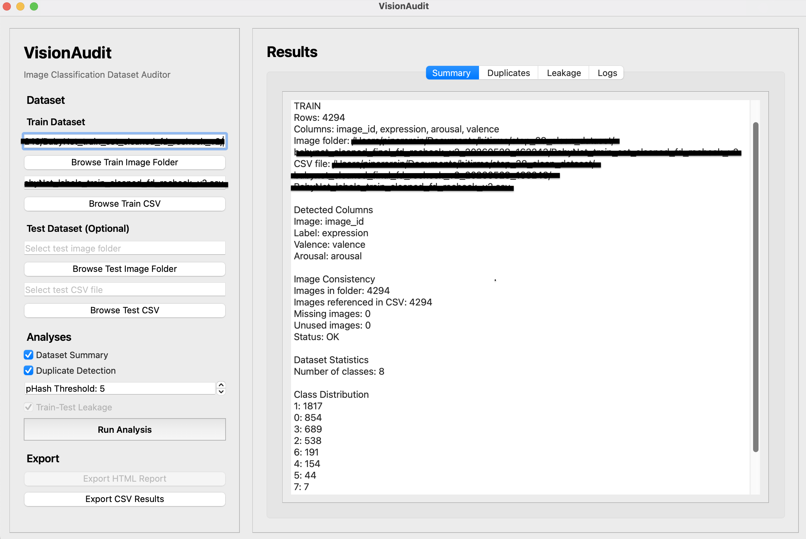
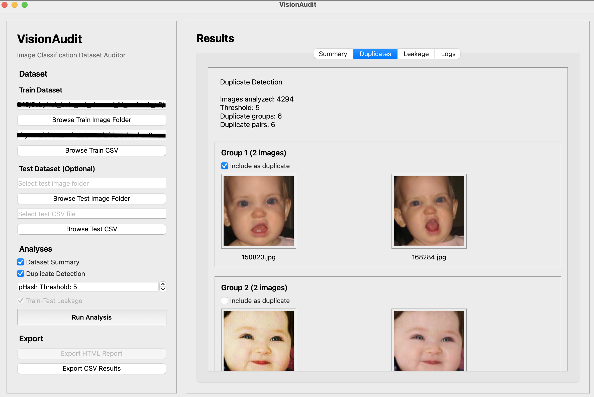
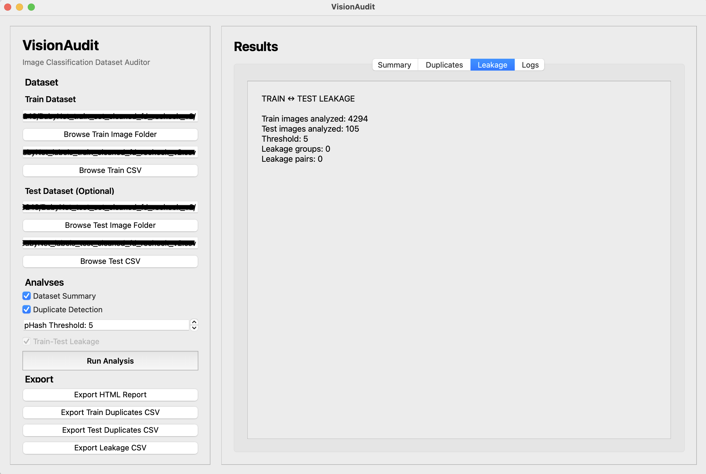
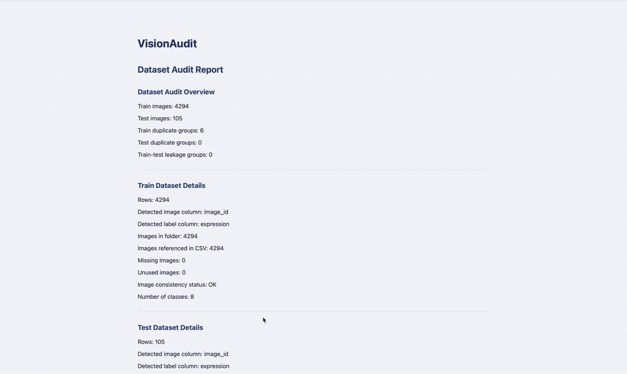

# VisionAudit

VisionAudit is a cross-platform desktop application for auditing image classification datasets before model training.

It helps identify common dataset quality issues such as missing images, unused files, class imbalance, duplicate images, and train–test data leakage through a graphical interface — without modifying the original dataset.

Built with Python and PySide6, VisionAudit provides dataset statistics, visual inspection of potential duplicates, manual review, and exportable audit reports.

## Features

### Dataset Validation
- Load a training image directory and CSV annotation file
- Optionally load a test dataset
- Automatically detect common image and label columns
- Compare CSV image references with files in the image directory
- Identify missing and unused images
- Display image consistency status

### Dataset Statistics & Visualization
- Number of samples and classes
- Class distributions for train and test datasets
- Class distribution charts
- Train vs. test dataset size visualization
- Class imbalance ratio and automatic warning indicators
- Use class labels directly from the dataset CSV

### Duplicate Detection
- Perceptual hash (pHash) based duplicate detection
- Adjustable Hamming distance threshold
- Separate duplicate analysis for train and test datasets
- Grouping of visually similar images
- Thumbnail-based visual comparison
- Manual review of detected duplicate groups
- Exclusion of potential false-positive groups before export

### Train–Test Leakage Detection
- Detect visually similar images appearing across training and test datasets
- Group potential leakage matches
- Display train and test images for visual inspection
- Manually review and exclude false-positive leakage groups
- Export reviewed leakage results to CSV

### CSV Export
- Export reviewed train duplicate groups
- Export reviewed test duplicate groups
- Export reviewed train–test leakage matches
- Preserve original dataset metadata columns
- Exclude groups deselected during manual review

### HTML Audit Reports
- Export standalone HTML audit reports
- Summarize train and optional test dataset statistics
- Include class distributions and imbalance indicators
- Display detected duplicate and leakage group counts
- Include group counts after manual review
- Readable, styled reports that can be opened in a web browser

### Application Interface
- Separate Summary, Duplicates, Leakage, and Logs tabs
- Scrollable results and thumbnail-based review
- Analysis progress messages
- Remember previously selected dataset paths

## Screenshots

### Dataset Summary



### Duplicate Detection and Review



### Train–Test Leakage Detection



### HTML Audit Report



## Installation

### Requirements

- Python 3.10 or newer
- macOS or Windows
- Dependencies listed in `requirements.txt`

### 1. Clone the Repository

```bash
git clone https://github.com/pinarercin/VisionAudit.git
cd VisionAudit
```

### 2. Create a Virtual Environment

```bash
python -m venv .venv
```

Activate the environment.

**macOS:**

```bash
source .venv/bin/activate
```

**Windows (Command Prompt):**

```bat
.venv\Scripts\activate.bat
```

**Windows (PowerShell):**

```powershell
.\.venv\Scripts\Activate.ps1
```

### 3. Install Dependencies

```bash
pip install -r requirements.txt
```

### 4. Run VisionAudit

```bash
python main.py
```

## How to Use

1. Select the training image folder and its CSV annotation file.
2. Optionally select a test image folder and CSV annotation file.
3. Adjust the pHash threshold if needed.
4. Click **Run Analysis**.
5. Inspect dataset statistics and class distributions in the **Summary** tab.
6. Review potential duplicate groups in the **Duplicates** tab.
7. If a test dataset is provided, inspect potential train–test leakage in the **Leakage** tab.
8. Uncheck any detected groups you consider false positives.
9. Export reviewed results as CSV files or generate an HTML audit report.

**Note:** The application identifies potential duplicates and leakage using perceptual similarity. Detected matches should be reviewed before making dataset-cleaning decisions.

## Dataset Requirements

VisionAudit expects:

- An image directory containing the dataset images
- A CSV annotation file with an image identifier or filename column
- A label column for class-based statistics

Common image column names include:

`image_id`, `image`, `image_name`, `filename`, `file_name`, `filepath`, `file_path`, `img`, `img_path`

Common label column names include:

`label`, `class`, `class_name`, `category`, `target`, `expression`, `emotion`

Optional valence and arousal columns can also be detected when present.

Class labels are read directly from the CSV file. VisionAudit does not require a predefined set of classes.

The test dataset is optional. When provided, both its image folder and CSV annotation file must be selected.

Supported image formats include:

`.jpg`, `.jpeg`, `.png`, `.bmp`, `.webp`, `.tif`, `.tiff`

## Duplicate Detection

VisionAudit uses perceptual hashing (pHash) to identify visually similar images.

The pHash threshold represents the maximum Hamming distance allowed between image hashes.

- **Lower threshold:** Stricter matching, fewer potential duplicates
- **Higher threshold:** More permissive matching, potentially more false positives

The default threshold is **5**.

Potential duplicates are grouped and displayed as thumbnails. All detected groups are initially included, but users can uncheck groups they consider false positives.

CSV exports respect these review decisions.

## Train–Test Leakage

Data leakage can occur when identical or visually similar images appear in both training and test datasets, potentially affecting the reliability of model evaluation.

VisionAudit compares images across the two datasets using pHash and displays potential leakage groups for manual review.

Leakage detection is available when both the test image folder and test CSV file are provided.

## HTML Audit Reports

VisionAudit can generate a standalone HTML report containing:

- Dataset overview
- Train and test dataset details
- Image consistency information
- Class distribution tables
- Class imbalance ratios and statuses
- Duplicate detection summaries
- Train–test leakage summaries
- Counts reflecting manual review decisions

Reports can be opened locally in a web browser without requiring a server.

## Project Structure

```text
VisionAudit/
├── analysis/
│   ├── phash_duplicate_analyzer.py
│   └── phash_leakage_analyzer.py
├── assets/
│   ├── visionaudit_summary.png
│   ├── visionaudit_duplicates.png
│   ├── visionaudit_leakage.png
│   └── visionaudit_html_report.gif
├── parsers/
│   └── dataset_parser.py
├── reports/
├── ui/
│   └── main_window.py
├── utils/
├── main.py
├── requirements.txt
└── README.md
```

## Read-Only Dataset Policy

VisionAudit never deletes, renames, moves, or modifies original images or annotation files.

All dataset analysis is read-only. CSV and HTML reports are saved as separate output files.

## Limitations & Future Improvements

- pHash-based detection identifies visual similarity, not guaranteed semantic duplicates.
- Higher pHash thresholds may produce false-positive matches.
- Performance optimizations for very large datasets remain future work.
- Additional testing across different dataset structures and operating systems is planned.

## Status

**Current release: v1.0.0**

VisionAudit v1.0 introduces a complete dataset auditing workflow, including dataset validation, class distribution visualization, duplicate detection, train–test leakage analysis, manual review, and CSV/HTML report export.

## License

This project is licensed under the MIT License. See the `LICENSE` file for details.

## Author

**Pınar Erçin**  
AI & Data Engineer

GitHub: [@pinarercin](https://github.com/pinarercin)
